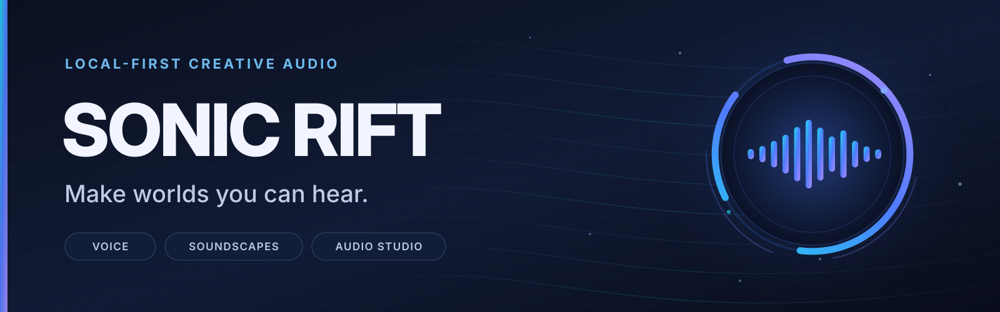
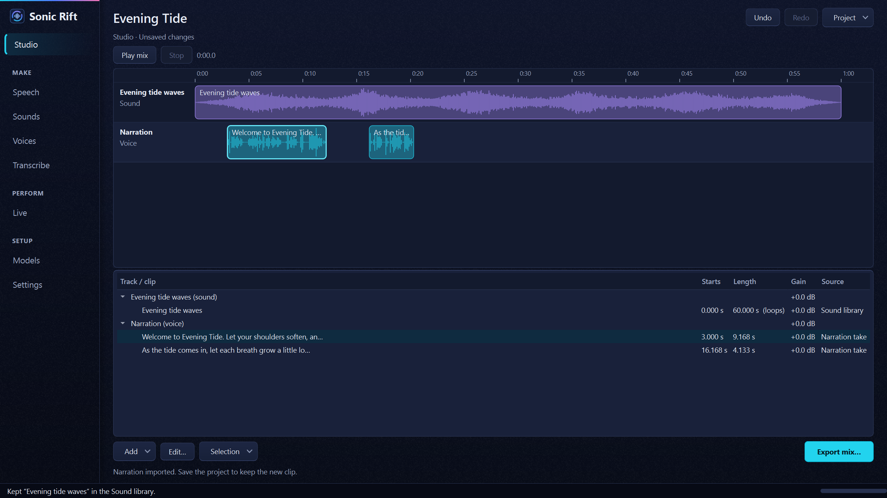
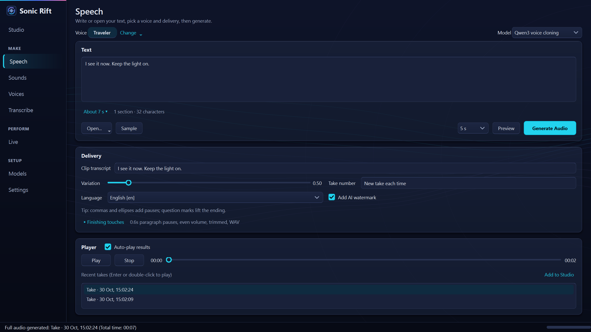
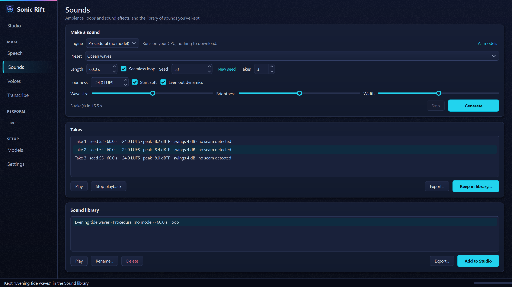
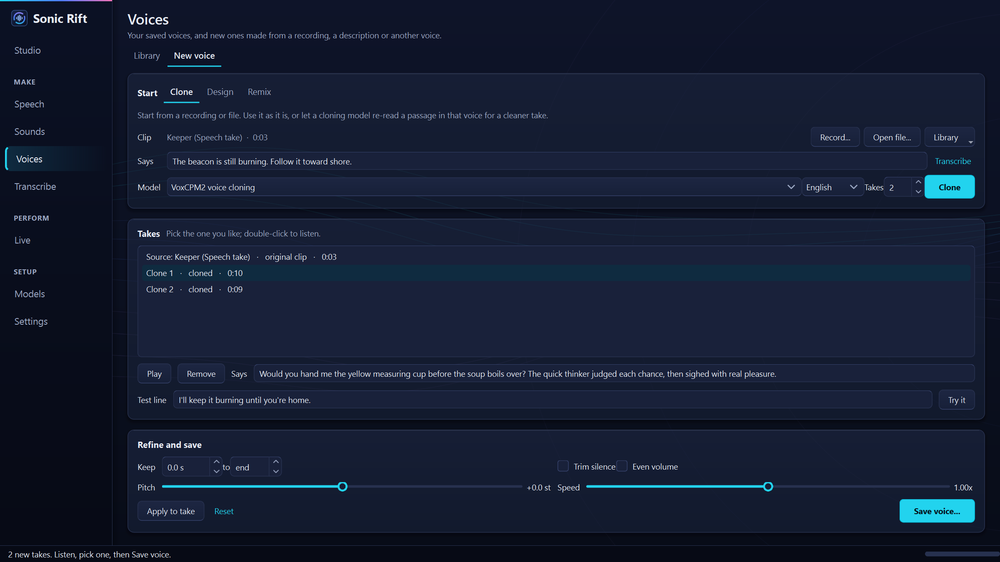
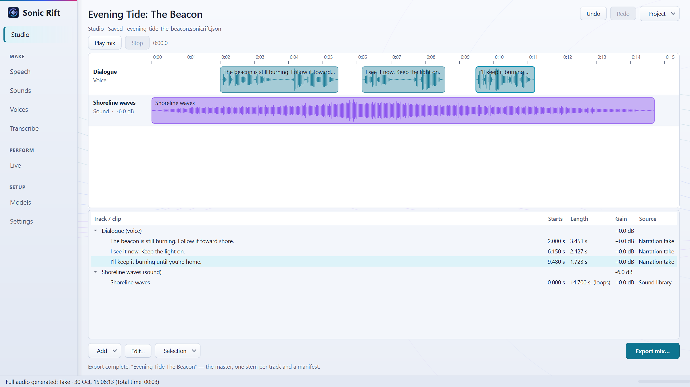

# Sonic Rift



> **Make worlds you can hear.** Local-first creative audio for voices, soundscapes, and the ideas that connect them.

**Sonic Rift** is a Windows-first, local-first desktop creative-audio workbench. It combines multiple speech engines with voice design, cloning, narration, transcription, and soundscape generation. The long-term direction includes arranging environmental audio with spoken performances; these composition workflows are still evolving and should not be confused with independently validated release features.

Sonic Rift integrates [Resemble AI's Chatterbox TTS](https://github.com/resemble-ai/chatterbox) as one of several optional speech providers. Copyright and dependency attribution is maintained in [Licensing and third-party notices](THIRD_PARTY_NOTICES.md) and the repository's [LICENSE](LICENSE).

**Who it's for:** creators who want narration, voices and ambient sound made on their own Windows PC (meditation and wind-down audio, stories, games, streams, video), without sending text or recordings to a cloud service.

**How it fits together:** each generator has its own page (**Speech**, **Sounds**, **Voices**, **Transcribe**, and **Live** for real-time output), and the **Studio** is where their output comes together: arrange speech and sounds on a timeline, play the mix, and export a mastered file with one stem per track. Arranging, trimming and the Studio itself are newer and still evolving; see [Current status](#current-status).

The current voice workbench supports six speech engines, model discovery and management, reusable voices, multi-speaker conversations, document narration, pronunciation tools, subtitles, Whisper transcription, and audio finishing. The **Sounds** workspace provides ambience, loops, effects, presets, and a reusable sound asset library. See [CHANGELOG.md](CHANGELOG.md) for release-by-release details, and [the branding guide](assets/branding/README.md) for visual assets and usage.

| Engine | From | Does |
| --- | --- | --- |
| **Chatterbox** | Resemble AI | Voice cloning and multilingual synthesis (default speech provider) |
| **Qwen3-TTS** | Alibaba | Preset voices with styles, voice design, voice cloning |
| **VoxCPM2** | OpenBMB | Voice cloning with styles, voice design, 30 languages at 48 kHz |
| **OmniVoice** | k2-fsa | Fast voice cloning and design in 600+ languages (non-commercial weights) |
| **VibeVoice** | Microsoft Research | Multi-speaker conversations (research use) |
| **Kokoro** | hexgrad | Dozens of fast preset voices, light on hardware |

Transcription (audio to text) runs locally too, with OpenAI's open [Whisper large-v3 turbo](https://huggingface.co/openai/whisper-large-v3-turbo).

Text, recordings, generated audio, saved voices and model configuration stay on your machine unless you explicitly use a feature that talks to an external service, such as Hugging Face discovery/downloads or Google Docs import.

> [!NOTE]
> **Compatibility note:** Existing runtime folders such as `chatterbox_outputs/` retain their historical names to avoid breaking saved files and scripts. They do not indicate that the app is limited to Chatterbox.

See [CHANGELOG.md](CHANGELOG.md) for the long version of how this got out of hand.

## System Requirements & Platform Compatibility

**Before installing:** Sonic Rift runs AI speech models on your own computer. Being able to open the desktop app does not guarantee that a particular model will install, use hardware acceleration, or generate audio successfully.

| Platform | Current project status | What to expect |
| --- | --- | --- |
| **Windows 10/11 (64-bit)** | **Primary maintained path** | `run.bat` automates setup; NVIDIA CUDA acceleration is supported by the installer, subject to compatible drivers and hardware. |
| **macOS on Apple Silicon (M1–M4, including M4 MacBooks)** | **Experimental / unverified** | A `run.sh` launcher exists, but macOS has **not been tested by the maintainer**. Metal (MPS) acceleration is unverified; installation may fail or run on CPU. Community test reports are welcome. |
| **Linux** | **Experimental / unverified** | A `run.sh` launcher exists; dependency and GPU support are not validated to the same standard as Windows. |

**Local requirements and recommendations**

- **Python:** The application environment is pinned to **Python 3.11**. On Windows, a working `python` command and `uv` are needed to bootstrap it. On macOS/Linux, install Python 3.11 and `uv` before running the shell launcher.
- **Graphics:** An NVIDIA GPU is recommended for the maintained Windows path. Some engines may work on CPU, typically with much slower generation. Apple's M-series GPU is **not yet a verified acceleration target** for this application.
- **GPU memory:** Requirements vary by engine. The current project guidance ranges from roughly **2 GB VRAM for Kokoro**, **4 GB minimum for Chatterbox**, and **6–10 GB or more** for larger engines. These are estimates, not confirmed compatibility guarantees. See [per-model guidance](#prerequisites).
- **System RAM:** No tested minimum has been established. More memory may be necessary for larger models and CPU inference; do not treat GPU VRAM figures as RAM requirements.
- **Storage:** Plan for **multiple gigabytes per model**, plus Python/PyTorch and separate optional-engine environments. Individual configured model downloads are approximately **0.4–5.4 GB** before installation overhead. Available disk space should exceed the chosen model's download size substantially.
- **Network:** Internet access is needed for initial dependencies and model downloads; downloaded models can generate locally afterward. No cloud API key is required for normal local use.
- **Optional:** FFmpeg enables additional audio formats and improved pitch/speed processing; a microphone is needed only for recording.

**Have an Apple Silicon Mac (including an M4 MacBook)?** You're welcome to try it and share results, but **macOS has not been tested by the maintainer** and is **not a supported or guaranteed setup**. Potential issues include unavailable or incompatible Python dependencies, failure of the installer to select a working PyTorch build, CPU-only inference instead of Metal/MPS acceleration, model-specific operators that do not run on MPS, slow performance, or failures during model loading and audio generation. A successful app launch alone does not establish engine compatibility.

**Community testing is welcome.** If you try it on macOS, please [open a GitHub issue](https://github.com/Knapp-Kevin/sonic-rift/issues/new) with your Mac model and chip, macOS version, RAM, Python version, the engine/model tested, installation steps, whether inference used MPS or CPU, whether audio was generated, and relevant error logs (with tokens and private paths removed). Reports of both success and failure are useful. No Mac hardware or maintainer-led Apple testing is currently available; community reports will help establish what actually works.

## Table of Contents

- [System Requirements & Platform Compatibility](#system-requirements--platform-compatibility)

- [Quick Start](#quick-start)
- [Screenshots](#screenshots)
- [Current status](#current-status)
- [How This Got Out of Hand](#how-this-got-out-of-hand)
- [Features](#features)
- [Local API](#local-api)
- [Google Docs sign-in setup](#google-docs-sign-in-setup)
- [Language Support](#language-support)
- [Prerequisites](#prerequisites)
- [Manual Installation](#manual-installation-advanced)
- [Project Structure](#project-structure)
- [Troubleshooting](#troubleshooting)
- [PyTorch & Reproducibility](#important-notes-on-pytorch-installation--reproducibility)
- [Contributing](#contributing)
- [Acknowledgements](#acknowledgements)

## Quick Start

If you are on Windows and just want the app to work, use this section. You do **not** need an OpenAI API key, a Hugging Face account, or prior Python experience for normal local generation.

### 1. Install the two required tools

Install **Python 3.11 or newer** from [python.org](https://www.python.org/downloads/windows/).

During the Python installer, enable **Add python.exe to PATH**. Then open **Command Prompt** and verify:

```bat
python --version
```

The exact system Python version is not important as long as that command works. The launcher uses `uv` to create the app's required Python 3.11 environment.

Next install **uv**, which manages the app's Python environment and packages:

```bat
python -m pip install uv
```

Verify that Windows can find it:

```bat
uv --version
```

If either command says it is not recognized, close and reopen Command Prompt after installation. If it still fails, see [Troubleshooting](#troubleshooting).

> [!NOTE]
> **FFmpeg is optional for initial setup.** Install it later if you want MP3 support and the best speed/pitch processing. The app itself can start without it.

### 2. Download Sonic Rift

Choose **one** method.

**Easiest: download a ZIP**

1. On this GitHub page, click **Code → Download ZIP**.
2. Open the downloaded ZIP.
3. Extract the entire folder somewhere you can keep it, such as `Documents\Sonic Rift`.
4. Open the extracted folder. Do not run the app from inside the ZIP preview.

**Or, if you use Git:**

```bat
git clone https://github.com/Knapp-Kevin/sonic-rift
cd sonic-rift
```

### 3. Start the app

Double-click **`run.bat`**.

That is the normal launcher. You do **not** need to run `setup_env.bat` first.

On the first run, the launcher will:

1. create the private `.venv` Python environment used by the app;
2. install the locked Python dependencies;
3. choose and install the appropriate PyTorch build for your hardware;
4. start Sonic Rift;
5. download the default Chatterbox model when it is first needed.

Keep the setup window open while it works. Later launches reuse the environment and are much shorter.

If setup fails, the launcher tells you where the installer log was written. Look in the repo's **`logs`** folder for the newest `installer_*.log`.

### 4. Make your first audio

When the app opens:

1. Go to **Speech**.
2. Type or paste a short sentence into the text box.
3. Keep the default model and voice for the first test.
4. Click **Preview** to make a short sample.
5. If it sounds right, click **Generate Audio**.
6. Play the result in the built-in player. Generated files are also kept under `chatterbox_outputs/`.
7. Optional: **Add to Studio** puts the take on the Studio timeline, where you can add a sound from **Sounds**, play the mix and export it.

Once that works, the rest of the app is safe to explore:

- **Voices › New voice** creates, clones, remixes and refines voices; the **Studio** arranges speech and sounds into a mix.
- **Live** speaks typed lines and soundboard pads straight to an audio output, with a queue and stop controls.
- **Voices** stores the voices you save.
- **Transcribe** turns recordings into text.
- **Model** switches engines, installs optional models and discovers compatible Hugging Face models.
- **Advanced** contains pronunciation, audio finishing, export and local API settings.

Optional engines install their own isolated environments when you first choose them. That is expected and prevents their incompatible dependencies from breaking the main app.

### 5. Normal use after installation

After the first successful setup, just double-click **`run.bat`** whenever you want to use the app. The launcher checks the environment, repairs it when needed, and then starts the application.

You normally should **not**:

- activate the virtual environment yourself;
- run `setup_env.bat` separately;
- install packages into `.venv` by hand;
- copy optional-engine packages into the main environment.

Those are troubleshooting or development tasks, not normal use.

### Launchers

- `run.bat`: **Windows users should start here.** It prepares or repairs the environment, then launches the app.
- `setup_env.bat`: setup only. Useful for troubleshooting or development.
- `run.sh` + `setup_env.sh`: best-effort macOS/Linux equivalents, not validated to the same level as Windows.

Windows remains the primary maintained path. Installer decisions are written to `logs/installer_*.log`; start-up problems to `logs/app_startup_*.log`.

## Screenshots

Captured from the running app (build `cd9e030`, Windows 11) during one demo session with fictional content and built-in voices. Details, alt text and checksums: [docs/marketing](docs/marketing/README.md).



| Speech | Sounds |
| --- | --- |
|  |  |

| Voices: clone a voice | Studio (light theme) |
| --- | --- |
|  |  |

**Walkthrough (about a minute, with sound):** [MP4](docs/marketing/video/sonic-rift-walkthrough.mp4) · [captions](docs/marketing/video/sonic-rift-walkthrough.en.vtt) · [transcript](docs/marketing/video/transcript.md). Waiting for renders is shortened; everything shown is the real app.

<details>
<summary>Earlier screenshots (older builds, before the Studio and the new sidebar)</summary>

These show pages as they looked before October 2026: Create is now **Speech**, and the voice studio is **Voices › New voice**.

| | |
| --- | --- |
|  |  |
|  |  |
|  |  |

</details>

## Current status

- **Maintained platform:** Windows 10/11 64-bit, run from source (`run.bat`). macOS and Linux launchers exist but are **experimental and unverified**.
- **Working in the current Windows build:** Speech (six engines), Voices (library, recording, clone/design/remix), Sounds (procedural ambience and loops, optional sound models), Transcribe, Models, and Live output to local audio devices. Integrated acceptance results are tracked in [#61](https://github.com/Knapp-Kevin/sonic-rift/issues/61).
- **Newer, still evolving:** the Studio timeline (arranging, moving and trimming clips, preview, export with stems). Its export currently stops at about 11.7 minutes per track while a longer-export approach is decided.
- **Not verified yet:** Live output through virtual cables, Discord, Zoom or OBS.
- **Not available:** an installer, code-signed builds or a store listing.

## How This Got Out of Hand

Sonic Rift brings local voice synthesis, sound generation, narration, and audio processing into one creative workbench. Its supported capabilities and release limitations are documented below.

Current additions include:

- **Six speech engines grouped by capability.** Chatterbox, Qwen3-TTS, VoxCPM2, OmniVoice, VibeVoice and Kokoro provide different combinations of cloning, preset voices, voice design and conversations.
- **Multi-speaker conversations.** VibeVoice performs scripts with a different voice for each speaker.
- **Model-aware hardware guidance.** Model tiles show licensing, expected download size and GPU-memory requirements against the current machine.
- **A voice studio (Voices › New voice).** Clone a recording, design a voice from a description (several candidates at once), or remix a voice with words; clean it up, adjust pitch and speed, and save it frozen so it sounds the same in every render.
- **Voice first.** Generate starts from a saved voice, and only offers the models that can speak it.
- **Document narration.** Open long text, documents and Google Docs, preview a few seconds, estimate generation time, render in sensible sections, and keep partial work if generation is stopped.
- **Hugging Face model discovery.** Search compatible models, inspect compatibility and licensing, and add supported repositories without hand-editing configuration files.
- **Transcription.** Turn audio into text with Whisper, save it as text or subtitles, fill in a voice clip's transcript, or send it back to Generate.
- **Pronunciation controls and subtitles.** Maintain a pronunciation dictionary and generate SRT or WebVTT from the known generation timeline.
- **Audio finishing.** Adjust paragraph pauses, even out volume, trim silence, change speed or pitch, and export WAV, FLAC or MP3.
- **A local HTTP API.** Use the same engines and voice library from other software through OpenAI-compatible or native endpoints.
- **A redesigned desktop interface.** Studio, Speech, Sounds, Voices, Transcribe, Live, Models and Settings pages with light and dark themes.

The goal is one coherent creative-audio application, not a collection of unrelated engine interfaces.

## Features

The sidebar is organized by what you're doing: the **Studio** (arrange speech and sounds on a timeline and export the mix), then **Make** (**Speech**: write or open text and generate it; **Sounds**: ambience and effects; **Voices**: your library, and **New voice** to make one; **Transcribe**), **Perform** (**Live**: speak to a device in real time) and **Setup** (Models, Settings).

<details>
<summary><strong>Studio</strong></summary>

- **One place for everything you make:** **Add to Studio** on Speech (a take) and on Sounds (a kept sound) puts it on the timeline; **Add** in the Studio also takes a saved sound, a narration file or a narration script. Narration lands on one Narration track, one line after another.
- **Arrange:** drag clips to move them and drag their edges to trim them (the source audio is never changed); loop sounds, set gain and fades, mute tracks, reorder them. Every edit can be undone.
- **Listen:** **Play mix** plays the arrangement with narration ducking the background; click the ruler to jump.
- **Export:** a mastered mix (WAV, plus MP3/OGG if you like) at about -16 LUFS, one stem per track and a manifest, in a new folder.
- **Projects** are `.sonicrift.json` files. A project changed outside the app is never silently overwritten.
- **Limits today:** export stops at about 11.7 minutes for a single track (less with more tracks); narration scripts need a take from Speech before export.

</details>

<details>
<summary><strong>Speech</strong></summary>

- **Voice first:** pick a voice with **Change** (one of yours, or a model's built-in voices), and the model list shows only the models that can speak it. A clip voice, or one made under New voice, works with every cloning model; picking one while a non-cloning model is loaded loads a cloning model for you.
- Per-model time estimates for the current text (click the estimate to compare and switch).
- Plain-language delivery controls, with engine-specific settings where they apply: speaker and style for Qwen, voice per language for Kokoro, style and clip transcript for VoxCPM, and a cast of voices for VibeVoice. Designing a voice happens in Voices › New voice.
- Variation and take-number controls for repeatable takes where supported.
- Language selection based on the active model.
- A built-in player with history, seeking and optional auto-play.

</details>

<details>
<summary><strong>Live</strong></summary>

**Live** speaks with the loaded model and voice straight to an audio device, without rendering a file first. It uses the same voice, language and pronunciation settings as Speech.

- **Speak:** type a line and click **Speak** (or **Ctrl+Enter**). New lines queue in order; **Stop current** cuts the current line and keeps the queue, **Stop all** clears everything, **Repeat last** says the last line again. The queue is capped (25 items, about 10 minutes).
- **Streaming:** VoxCPM2 streams natively (live quality **Low latency · 6 steps** by default, or 8 or 10 steps; Speech always uses 10). Kokoro streams in short sections. Other engines speak after finishing the line. The status line says which mode is in use and warns when generation falls behind playback.
- **Soundboard:** save lines as pads on one or more boards, or import WAV/FLAC/OGG/MP3/AIFF clips. A spoken pad is cached after its first render, so it plays again without the model or GPU, and is marked **rebuild needed** if its voice or settings change. Pads can queue, interrupt, or be ignored while busy; favourites, tags, search and reordering are built in.
- **Shortcuts:** on the Live page, **Alt+1…9** triggers pads, **Ctrl+.** is Stop all. Optional Windows-wide hotkeys can be assigned to pads and Stop all, with a switch that turns pad hotkeys off at once.
- **Mic effects:** pass a microphone through gain, tone and compression (or untouched) to the same outputs. The microphone is processed in memory and never recorded to disk.
- **Routes:** **Local output**, or an external route (**virtual microphone**, **Discord**, **Zoom**, **OBS**, **Other app**) that starts disarmed every launch and must be armed before anything is sent. An optional monitor plays the same audio on a second device. A missing saved device is shown as unavailable; Live never falls back to the speakers silently. With a virtual audio cable you already have, send to its playback side (often "CABLE Input") and pick its recording side ("CABLE Output") as the microphone in the other app; **Setup…** shows the steps. Sonic Rift doesn't install a virtual microphone driver.
- **Privacy and provenance:** the Live history is session-only and can be cleared; **Clear cache** removes cached pad audio. The header shows the voice's origin and the watermark policy; **Copy diagnostics** copies timing, route and buffer figures without the spoken text.

Live Voice has been validated on Windows 11 with local outputs (HDMI and USB digital), a USB microphone for Mic Effects, Kokoro and VoxCPM2, and a 30-minute soak ([record](docs/live-voice-validation-2026-10-15.md)). Virtual-cable, Discord, Zoom and OBS routes are implemented but not yet validated end to end. To check a Windows route without a model, play a quiet test tone:

```bat
.venv\Scripts\python.exe scripts\live_voice_route_probe.py --output "CABLE Input" --monitor "YOUR HEADPHONES"
```

See the [Live Voice QA runbook](docs/live-voice-qa.md) and [app routing guide](docs/live-voice-app-routing.md).

</details>

<details>
<summary><strong>Documents and long text</strong></summary>

- Open `.txt`, `.md` and `.docx` files, or a Google Doc, while keeping the text editable.
- Live duration, section and character estimates.
- **Preview** about 3, 5 or 10 seconds before committing to a long render. **Keep this take** locks the preview's take.
- Progress and time remaining during long renders. Stopping keeps finished sections as a `_partial` file.
- Paragraph-aware sectioning: text is split where a reader would pause, never mid-phrase or across paragraphs, and pauses between sections match the kind of break.

</details>

<details>
<summary><strong>Sounds (ambience and sound effects)</strong></summary>

Sound beyond speech: ambience loops, rain and waves, tonal beds and UI chimes, kept with a record of how each was made.

- **Two engines, both free of license restrictions:**

  | Engine | License | Speed (RTX 5070 Ti) | GPU memory |
  | --- | --- | --- | --- |
  | **Procedural** | your own work | 30 s loop in ~2 s on the CPU | none |
  | **MOSS-SoundEffect v2** | Apache-2.0, no restrictions; training data not disclosed | ~23 s per take; long clips are stitched | ~15 GB (the app offers to unload the voice model) |

  - **Procedural** needs no model or download. Presets: ocean, rain, thunderstorm, wind, drone and three UI chimes.
  - **MOSS** runs in its own environment, and is listed with the voice models on **Models → Sounds**. Before installing, the app shows the license and download size and asks. In listening tests it suited ocean, rain and richer tonal beds; the procedural engine suits simpler, exactly repeating beds.
  - Stable Audio 3 Small SFX was evaluated and dropped: its ambience was rejected in listening tests, and its license has conditions.
- **Takes:** make 1 to 6 at once with consecutive seeds. The same engine, settings and seed give the same sound again.
- **Seamless loops:**
  - Procedural loops repeat exactly by construction.
  - MOSS folds the tail over the head, and generates a little extra so loops still come out at the length you asked for.
  - Each take shows a seam check, which flags a join only if it's more abrupt than anything inside the sound. "No seam detected" isn't a listening test.
- **Mastering:**
  - Every take is mastered to a loudness target (LUFS), with true peaks under -1 dB.
  - A gentle limiter stops one loud moment from making the whole take quiet.
  - **Start soft** begins a loop at its quietest moment, so it opens softly and builds; nothing is faded, so it stays seamless.
  - **Even out dynamics** slowly levels loud and quiet stretches so swells don't jump out at high volume; each take shows how much its level swings.
  - Calm ambience defaults to about -24 to -27 LUFS (adjustable per take).
  - Mono models are spread into stereo without changing their mono mix.
- **Asset Library:** keep a take with its name, engine, model, license, preset or prompt, seed and settings. Rename, delete, or export as a WAV master, OGG or MP3.

</details>

<details>
<summary><strong>Voices: New voice</strong> (the voice studio)</summary>

One place to make a voice, so generating is just a matter of picking it. Every voice New voice saves is frozen: a clip plus the words it says. Any cloning model can speak it, and it sounds the same in every render and batch.

- **Clone:** record (with the guided recorder), open a file, or start from a library voice. Fill in what it says with **Transcribe** (Whisper). Use the clip as it is, or have a cloning model (Chatterbox, Qwen3, VoxCPM2, OmniVoice) re-read a passage in that voice for cleaner takes, with Chatterbox's expressiveness and pacing.
- **Design:** describe a voice (or pick OmniVoice attributes) and make 1 to 4 candidates at once with Qwen3, VoxCPM2 or OmniVoice. Each take is a different voice from the same description; keep the one you like, or change the wording and roll again.
- **Remix:** start from a voice and change it with words, such as "older, slower and warmer", using VoxCPM2's styled cloning.
- **Try it:** hear the selected take say any test line before you commit.
- **Refine:** keep just part of a clip, trim silence, even out the volume, and shift pitch or speed (formant-preserving with FFmpeg's Rubber Band). **Apply to take** makes a new take to compare.
- **Save voice** puts the selected take in the library with its name, tags and notes.

</details>

<details>
<summary><strong>Voice library</strong></summary>

The **Voices** page holds your saved voices: search, tag, rename, preview, and click one to use it on Speech. New voices start under **New voice**.

- **Clip voices:** recordings or imported audio plus transcript. They work with every cloning model.
- **Preset voices:** built-in voices from engines such as Kokoro or Qwen.
- **Designed and remixed voices:** made under New voice and saved frozen as a clip, so picking one later, even after restarting the app, renders the same voice every time. **Open in New voice** (in a voice's ⋯ menu) brings any voice back to refine it. **Make clip** turns an older description-only voice into a clip voice.
- Record with countdown, level monitoring, clipping and too-quiet warnings, and phonetically rich read-aloud passages; recordings open in New voice.

</details>

<details>
<summary><strong>Transcribe</strong></summary>

Speech to text with OpenAI's [Whisper large-v3 turbo](https://huggingface.co/openai/whisper-large-v3-turbo) (MIT license), on your own GPU or CPU. The model downloads once (about 1.6 GB) the first time you transcribe, and the app asks first.

- Open WAV, FLAC, OGG or MP3 (M4A, AAC and others with FFmpeg installed), or use the current voice clip.
- Language detection, or pick one of about 45 languages.
- Optional `[1:05]` timestamps; edit the text before using it.
- **Copy**, **Save text…**, or **Save subtitles…** as SRT or WebVTT, timed from the audio.
- **Send to Speech** puts the text (without timestamps) on the Speech page, ready to speak with any voice.
- **Transcribe clip** in a library voice's ⋯ menu fills in the clip's transcript, which Qwen, VoxCPM and OmniVoice cloning use.

On an RTX 5070 Ti, 20 seconds of speech takes about a second once Whisper is loaded. It uses about 1.7 GB of GPU memory. Whisper turbo transcribes; it doesn't translate.

</details>

<details>
<summary><strong>Models</strong></summary>

The Model page organizes engines by capability, in **Cloning**, **Presets**, **Design** and **Conversations** tabs, rather than pretending every speech model works the same way.

Each model tile shows:

- loaded / ready / download state, with the download size;
- license or usage restriction (green permissive, red non-commercial, amber unclear or research-only);
- expected GPU memory against the current machine (green fits, amber runs slower, red too small);
- typical speed, learned from your own runs.

**Discover on Hugging Face** searches for compatible repositories while filtering unsupported conversion formats. **+ Add repo…** lets you inspect a specific repository before downloading anything. A Hugging Face read token can be stored locally for gated or private repositories and higher Hub limits: **Get a token** on the Model page opens [Hugging Face's token page](https://huggingface.co/settings/tokens/new?tokenType=read) with the Read type already chosen.

</details>

<details>
<summary><strong>Engines</strong></summary>

- **Chatterbox** remains the default and the project's direct ancestor. It provides multilingual speech and voice cloning and runs in the main application environment.
- **Qwen3-TTS** supports preset voices, voice design and voice cloning. It runs in its own engine environment because its dependencies conflict with Chatterbox's. Long documents use batched generation, and a designed voice is carried through a document by cloning the first generated section.
- **VoxCPM2** supports voice cloning and voice design with multilingual 48 kHz output. Cloning can be steered with style text, and designed voices stay consistent across longer documents.
- **VibeVoice** performs multi-speaker conversations. Scripts use named turns such as `Linda: ...` and `Thomas: ...`, with a cast of sample or user-provided voices. MIT-licensed, but Microsoft's model card limits it to research use; review it before use.
- **OmniVoice** offers fast multilingual voice cloning and attribute-based voice design. Its pretrained weights are non-commercial (CC BY-NC 4.0); review the license before use.
- **Kokoro** is a small, fast preset-voice engine with multiple languages and low hardware requirements. It doesn't clone voices or take free-form style instructions.

Optional engines install themselves into their own `engines/<name>/.venv` the first time you load one of their models.

</details>

<details>
<summary><strong>Finishing touches and Settings</strong></summary>

- Paragraph pause control, volume levelling and start/end silence trimming.
- WAV, FLAC or MP3 output, chosen in **Finishing touches** on Speech.
- Speed and pitch adjustment (formant-preserving with FFmpeg's Rubber Band), also in Finishing touches.
- SRT and WebVTT subtitles, timed from the generation itself.
- A pronunciation dictionary with import/export and auditioning (**Settings**).
- An optional inaudible AI watermark on engines that don't add one themselves.

</details>

## Local API

Other programs on the same PC can use the app's models and voices. Enable it under **Settings → Local API**. The server listens only on `127.0.0.1` (port `8765` by default) and can require a bearer token. Speech requests use the same pipeline as the desktop UI: model selection, sectioning, batching, voice handling, pronunciation and finishing. It can also transcribe audio.

<details>
<summary><strong>Examples</strong></summary>

OpenAI-compatible speech endpoint (works with tools that already speak the OpenAI speech API):

```bash
curl http://127.0.0.1:8765/v1/audio/speech \
  -H "Content-Type: application/json" \
  -d '{"input":"Hello from my own computer.","voice":"alloy","response_format":"mp3"}' \
  -o speech.mp3
```

Native endpoint, with any model, library voice and subtitles:

```bash
curl http://127.0.0.1:8765/v1/speech \
  -H "Content-Type: application/json" \
  -d '{"text":"Chapter one...","model":"Kokoro voices","voice":"george","subtitles":"srt","format":"flac","name":"chapter1"}'
```

OpenAI-compatible transcription (Whisper must have been downloaded once from the Transcribe page):

```bash
curl http://127.0.0.1:8765/v1/audio/transcriptions \
  -F file=@interview.wav -F language=en -F response_format=srt
```

`response_format` is `json` (default), `text`, `srt`, `vtt` or `verbose_json` (with timed segments).

Discovery endpoints: `GET /v1/health`, `GET /v1/models`, `GET /v1/voices`.

### Experimental live PCM streaming

Add `"stream": true, "stream_format": "audio", "response_format": "pcm"` to a speech request to receive audio while it's being generated: natively from VoxCPM2 (48 kHz), in short sections from Kokoro (24 kHz).

```bash
curl http://127.0.0.1:8765/v1/audio/speech   -H "Content-Type: application/json"   -d '{"model":"VoxCPM2 voice cloning","input":"Hello while I am still being generated.","voice":"YOUR CLIP VOICE","stream":true,"stream_format":"audio","response_format":"pcm"}'   --no-buffer > speech.pcm
```

The stream is mono 16-bit little-endian PCM; headers give `X-Audio-Sample-Rate`, `X-Audio-Sample-Format`, `X-Streaming-Mode` and `X-Audio-Watermark`. Streaming requires `speed=1.0` and skips whole-file finishing (speed/pitch, final levelling, subtitles). VoxCPM2's native stream doesn't currently carry the Perth watermark; Kokoro's sections do. `scripts/benchmark_live_api.py` measures time to first audio and real-time factor. Design notes: [docs/live-tts-architecture.md](docs/live-tts-architecture.md). The desktop Live page uses the models directly, not this API.

</details>

## Google Docs sign-in setup

Shared Google Doc links work without signing in. Opening your private Docs needs a Google OAuth desktop client, set up once:

<details>
<summary><strong>Setup steps</strong> (about 5 minutes)</summary>

1. Create a project in [Google Cloud Console](https://console.cloud.google.com/).
2. Enable the **Google Drive API**.
3. Configure the Google Auth Platform branding/audience and add your account as a test user if the app remains in testing.
4. Create a **Desktop app** OAuth client and download its JSON file.
5. In Sonic Rift, choose **Open... → From Google Docs... → Set up...**, select that JSON file, then sign in.

The app requests read-only Drive access. Local auth information is stored in `google_auth.json`. While the Cloud project is in **Testing**, Google ends sign-ins after 7 days; setting it to **In production** avoids that, with an "unverified app" warning that's expected for an app only you use.

</details>

## Language Support

<details>
<summary><strong>Languages by engine</strong></summary>

- **Chatterbox multilingual:** Arabic, Danish, German, Greek, English, Spanish, Finnish, French, Hebrew, Hindi, Italian, Japanese, Korean, Malay, Dutch, Norwegian, Polish, Portuguese, Russian, Swedish, Swahili, Turkish and Chinese.
- **Qwen3-TTS:** English, Chinese, Japanese, Korean, German, French, Russian, Portuguese, Spanish and Italian.
- **VoxCPM2:** 30 languages plus several Chinese dialects.
- **OmniVoice:** 600+ languages.
- **VibeVoice:** English and Chinese.
- **Kokoro:** US/UK English, Spanish, French, Hindi, Italian, Brazilian Portuguese and Mandarin.

Community fine-tunes may add other languages. Use **Check** before assuming a Hugging Face repository is compatible.

</details>

## Prerequisites

<details>
<summary><strong>Software, hardware and disk space</strong></summary>

1. **Windows:** a working Python installation available as the `python` command. Python 3.11 or newer is the simplest choice. The maintained launcher creates its own Python 3.11 environment with `uv`.
2. **`uv`:** install with `python -m pip install uv`, then verify with `uv --version`. The [official uv installation guide](https://github.com/astral-sh/uv#installation) has alternative installation methods.
3. **NVIDIA GPU recommended.** CPU operation is possible for some engines but considerably slower. A GPU is not required merely to install or open the application.
4. **FFmpeg recommended, not required for first launch.** It enables broader audio-format support plus higher-quality speed/pitch processing.
5. **Disk space:** allow substantial room for PyTorch environments and model weights. Individual engines and models can take several gigabytes each. Do not assume the source-code download size represents the installed size.
6. **Internet access** for initial setup and model downloads. Generation runs offline afterwards for models already installed.
7. **No cloud API key required for normal local use.** Hugging Face authentication is optional unless you choose gated/private models or want higher Hub limits.

Approximate GPU memory, as a starting point (each model tile compares its needs with your GPU):

| Engine/model | Approximate VRAM guidance |
| --- | --- |
| Kokoro | ~2 GB |
| OmniVoice | 3–4 GB |
| Chatterbox | 4 GB minimum, ~6 GB comfortable |
| VoxCPM2 | ~6 GB minimum, ~8 GB comfortable |
| VibeVoice 1.5B | ~8 GB minimum, ~10 GB comfortable |
| Qwen3 0.6B | ~4 GB minimum |
| Qwen3 1.7B | ~6 GB minimum, more for full batching |

</details>

## Manual Installation (Advanced)

<details>
<summary><strong>Manual setup</strong> (macOS/Linux, or if the launcher fails)</summary>

`run.sh` and `setup_env.sh` mirror the launcher pattern for macOS/Linux but remain best-effort. Manual setup is the safer fallback outside Windows.

```bash
uv venv .venv --python 3.11
```

Activate the environment:

```bash
# Windows
.\.venv\Scripts\activate

# macOS/Linux
source .venv/bin/activate
```

Then:

```bash
uv pip sync requirements.lock.txt
python scripts/install_torch.py
python main.py
```

Optional engines install into their own `engines/<name>/.venv` environments from inside the app. Do not casually merge their Python dependencies into the main environment; several require mutually incompatible library versions, because dependency resolution apparently needed its own contribution to the comedy.

</details>

## Project Structure

<details>
<summary><strong>Where things live</strong></summary>

```
this-voice-thing/
├─ main.py                      start here: `python main.py` (run.bat / run.sh call it)
├─ run.bat, setup_env.bat       Windows launcher and setup (maintained)
├─ run.sh, setup_env.sh         macOS/Linux launcher and setup (best effort)
├─ this_voice_thing/            the application package
│  ├─ app.py                    start-up wrapper and crash logging
│  ├─ paths.py                  where code and data live
│  ├─ ui/
│  │  ├─ main_window.py         the window: sidebar, page layout, settings (run as __main__)
│  │  ├─ pages/                 one module per page, mixed into the window:
│  │  │                         generate, generation, documents, estimates, finishing, engine_controls, player,
│  │  │                         studio, soundscape, voice, voice_picker, library, voice_use, recording, transcribe, models, discover, model_loading,
│  │  │                         model_settings, advanced, api_server, pronunciations
│  │  ├─ dialogs/               recording, find/add models, voices and cast, pronunciation, Google Docs
│  │  ├─ threads.py             model loading, generation, installs, speech and transcription threads
│  │  ├─ api_bridge.py          hands local API requests to the window
│  │  ├─ common.py              start-up setup, model config and shared constants
│  │  ├─ widgets.py             small reusable widgets
│  │  ├─ theme.py               light/dark theme and its semantic colour tokens
│  │  └─ tiles.py               model and voice tiles
│  ├─ engines/
│  │  ├─ chatterbox_backend.py  Chatterbox, loaded in-process
│  │  ├─ worker.py              shared worker/environment support for the other engines
│  │  ├─ qwen.py, kokoro.py, voxcpm.py, omnivoice.py, vibevoice.py
│  │  └─ sound_models.py        the MOSS-SoundEffect worker for the Soundscape page
│  ├─ core/
│  │  ├─ model_registry.py      engines, capabilities, licenses, hardware needs, Hugging Face discovery
│  │  ├─ documents.py           document loading, sectioning, conversation scripts
│  │  ├─ audio_effects.py       joining, finishing, speed/pitch, export
│  │  ├─ subtitles.py           SRT/WebVTT from the render timeline
│  │  ├─ pronunciation.py       pronunciation dictionary
│  │  ├─ transcription.py       speech to text with Whisper
│  │  ├─ voice_studio.py        designing, cloning, remixing and refining voices (Voices › New voice)
│  │  ├─ soundscape/            procedural sounds, mastering (loudness, seams, export), the sound
│  │  │                         engine catalogue and the Asset Library
│  │  └─ voice_library.py       saved clip, preset and designed voices
│  └─ integrations/
│     ├─ local_api.py           local OpenAI-compatible and native HTTP API
│     └─ google_docs.py         Google Docs import and sign-in
├─ engines/<name>/              engine worker scripts, plus their own .venv once installed
├─ scripts/install_torch.py     picks a PyTorch build for your hardware (run by setup)
├─ scripts/restart_app.py      closes the app gracefully (it saves its settings) and starts it again
├─ tests/                       automated tests (`python -m unittest discover tests`)
├─ assets/                      icons and branding (assets/branding/)
├─ docs/screenshots/            README screenshots
├─ models.json                  the model list
└─ requirements.in, requirements.lock.txt, uv.toml
```

Your data stays in the project folder, where it has always been: `app_settings.json`, `models.json`, `chatterbox_outputs/`, `reference_recordings/`, `voice_library/`, `sound_library/`, `pronunciations.json`, `google_auth.json`, `logs/`, `.venv/` and each engine's `engines/<name>/.venv/`. Those historical data paths remain stable for compatibility with existing installations, even though the product is now Sonic Rift.

</details>

## Troubleshooting

<details>
<summary><strong>Common problems</strong></summary>

- **First launch appears stuck:** model and PyTorch downloads can take time. Check the Log page and `logs/`.
- **NVIDIA GPU exists but CPU is selected:** verify `nvidia-smi`, delete `.venv\.torch_checked`, then rerun `run.bat`.
- **Broken environment:** delete `.venv` and let the launcher rebuild it.
- **macOS/Linux launcher failure:** use the manual installation flow; shell support is still best-effort.
- **Window never appears:** inspect the newest `logs/app_startup_*.log`.
- **Microphone unavailable:** verify the device and Windows desktop-app microphone permissions.
- **Custom Hugging Face repo fails:** run **Check** in the model editor before downloading. GGUF, ONNX, MLX and partial fine-tunes are not necessarily drop-in compatible.
- **Unauthenticated Hugging Face warning:** optional. If you want one, **Get a token** on the Model page creates a free read token; paste it in and Save.

</details>

## Important Notes on PyTorch Installation & Reproducibility

<details>
<summary><strong>Why PyTorch is installed separately</strong></summary>

The project uses two deliberately separate mechanisms:

1. `requirements.lock.txt` keeps the main application's Python dependencies pinned.
2. `scripts/install_torch.py` selects a PyTorch runtime appropriate for the machine instead of pretending one wheel can sensibly serve every NVIDIA generation and CPU-only installation.

Optional engines use isolated environments where their dependencies conflict with the main application or each other. This costs disk space but avoids turning the primary environment into dependency soup.

</details>

## Live Voice architecture and research

Live Voice ships on the **Live** page (see Features). The design work is kept in-repo so future implementation does not require archaeological excavation through old chat logs.

- [Live Voice architecture](docs/live-voice-architecture.md)
- [Live Voice product specification](docs/live-voice-product-spec.md)
- [Live Voice adversarial review](docs/live-voice-adversarial-review.md)
- [Advanced integration decisions](docs/live-voice-advanced-integrations.md)
- [Microphone transformation roadmap](docs/live-voice-microphone-transformation-roadmap.md)

The advanced-integration decision record covers a future branded Windows virtual microphone, Zoom SDK PCM publishing, Discord Social SDK, and true realtime microphone voice conversion. Those are research/roadmap decisions, not claims that those integrations ship in the current main branch.

## Contributing

Issues and pull requests are welcome for application behavior, installer reliability, UI/UX, model compatibility, documentation and additional engines. See [CONTRIBUTING.md](CONTRIBUTING.md).

Please keep model licensing, attribution, local/private behavior and compatibility claims accurate. The product is independently branded. Licensing and compatibility obligations remain real.

## Acknowledgements

**Licenses and acknowledgements.** Sonic Rift is independently branded and supports multiple speech and sound providers. For the source-code provenance record and retained copyright notices, see [THIRD_PARTY_NOTICES.md](THIRD_PARTY_NOTICES.md), [LICENSE](LICENSE) and [the upstream provenance audit](docs/upstream-provenance-audit.md).

- **AcTePuKc and upstream contributors**, including [lowkeytea](https://github.com/lowkeytea), for historical source contributions; the preserved [original MIT copyright notice](LICENSE) and [provenance record](docs/upstream-provenance-audit.md) explain the remaining obligations.
- **Resemble AI** for [Chatterbox TTS](https://github.com/resemble-ai/chatterbox) (MIT).
- **Alibaba / the Qwen team** for [Qwen3-TTS](https://github.com/QwenLM/Qwen3-TTS) (Apache-2.0).
- **OpenBMB** for [VoxCPM](https://github.com/OpenBMB/VoxCPM) (Apache-2.0).
- **Microsoft Research** for [VibeVoice](https://github.com/microsoft/VibeVoice) and its associated research/model work.
- **k2-fsa / Xiaomi** for [OmniVoice](https://github.com/k2-fsa/OmniVoice) (code Apache-2.0; review the model weights' separate license).
- **hexgrad** for [Kokoro](https://huggingface.co/hexgrad/Kokoro-82M) and its [misaki](https://github.com/hexgrad/misaki) text front end (Apache-2.0).
- The developers and maintainers of PySide6, NLTK, PyTorch, librosa, FFmpeg, Rubber Band, `uv`, and the rest of the stack that makes this ridiculous thing work.

## Contributors ✨

Thanks goes to these wonderful people:

<!-- ALL-CONTRIBUTORS-LIST:START - Do not remove or modify this section -->
<!-- prettier-ignore-start -->
<!-- markdownlint-disable -->
<table>
  <tbody>
    <tr>
      <td align="center" valign="top" width="14.28%"><a href="https://github.com/Knapp-Kevin"><br /><sub><b>Kevin Knapp</b></sub></a><br /><a href="https://github.com/Knapp-Kevin/sonic-rift/commits?author=Knapp-Kevin" title="Code">💻</a> <a href="#ideas-Knapp-Kevin" title="Ideas, Planning, & Feedback">🤔</a> <a href="#design-Knapp-Kevin" title="Design">🎨</a> <a href="https://github.com/Knapp-Kevin/sonic-rift/commits?author=Knapp-Kevin" title="Documentation">📖</a> <a href="#projectManagement-Knapp-Kevin" title="Project Management">📆</a></td>
    </tr>
  </tbody>
</table>

<!-- markdownlint-restore -->
<!-- prettier-ignore-end -->
<!-- ALL-CONTRIBUTORS-LIST:END -->

This project follows the [all-contributors](https://github.com/all-contributors/all-contributors) specification. Contributions of any kind welcome!
