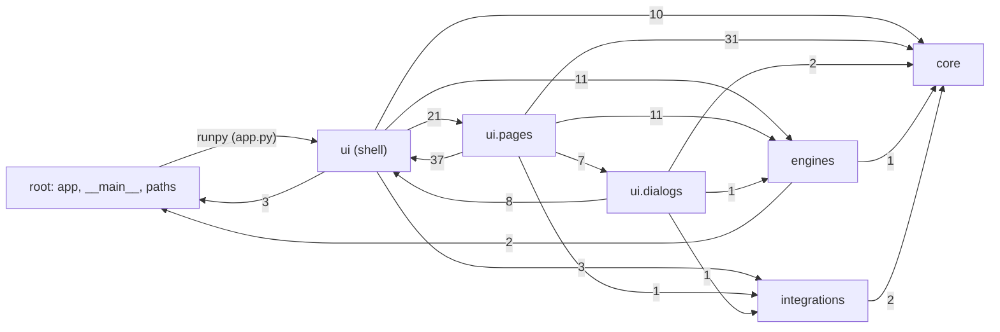

# Internal import graph of `this_voice_thing` (issue #55)

Method: `ast` parse of every module under `this_voice_thing/` (62 modules incl. package `__init__`s), resolving `import`/`from … import` (absolute and relative) to the longest known module (`tools/imports.py`, raw graph `tools/imports.json`). "Nested" = import not at column 0 (inside a function or `try`). Edges by string (`runpy`, subprocess paths) are listed separately. All VERIFIED from source unless marked.

## Key facts

- **No import cycles**, neither among top-level imports nor including nested imports (Tarjan SCC: none).
- **Layering is clean**: `core`, `engines`, `integrations` never import `ui`. `engines -> core` (1 edge: `vibevoice -> core.documents`), `engines -> paths` (2), `integrations -> core` (2, nested). Everything else flows from `ui`.
- **Hub modules** (fan-in): `ui.common` 17, `core.model_registry` 14, `core.documents` 11, `ui.widgets` 11, `ui.threads` 9, `ui.theme` 9.
- **Biggest fan-out**: `ui.main_window` 31 (imports all 21 page mixins + shell); `ui.pages.engine_controls`, `ui.pages.studio`, `ui.threads` 9 each.
- **String-based edges** (not visible to import analysis):
  - `app.main()` runs `runpy.run_module("this_voice_thing.ui.main_window")` (`app.py:75`), so `ui.main_window` shows fan-in 0 but is the GUI entry.
  - `engines/{kokoro,omnivoice,qwen,vibevoice,voxcpm}.py` spawn `engines/<name>/<name>_worker.py` by path (`WORKER = os.path.join(...)`). The 5 worker scripts import nothing from the package.
  - `engines.rvc_feasibility` has package fan-in 0 but is used by `scripts/rvc_feasibility.py`, `tests/test_rvc_feasibility.py` and `.github/workflows/rvc-feasibility-ci.yml`.
- External importers: `main.py -> app`; tests import `ui.threads`, `ui.taskbar`, `paths`, `ui.theme`, `core.transcription`, `integrations.local_api`, `core.voice_studio`, `ui.main_window`; `scripts/install_torch.py` and `scripts/restart_app.py` import nothing from the package.

## Dependence on upstream-derived code

Upstream-derived modules (from `audit_upstream_diff.md`): `engines.chatterbox_backend` (identical), `ui.common`, `ui.threads`, `ui.main_window`, `ui.pages.player`, `ui.pages.model_loading`, `ui.pages.generation`, `ui.pages.generate`, `ui.pages.model_settings`, `ui.widgets` (partial), `app`.

- **24 modules import upstream-derived code directly; 25 transitively** (adds `__main__`). All are in `ui` except `__main__`.
- `engines.chatterbox_backend` is imported **only** by `ui.common` (nested, in a `try`), but is reachable from 24 `ui` modules through `ui.common`/`ui.threads`.
- **Free of upstream-derived code (32 modules)**: all of `core.*`, all `engines.*` except `chatterbox_backend`, all `integrations.*`, `paths`, `ui.theme`, `ui.taskbar`, `ui.tiles`, `ui.dialogs.pronunciation`, `ui.dialogs.voices`, `ui.pages.advanced`, `ui.pages.voice`, and the package `__init__`s.
- Implication (INFERRED): reducing upstream-derived surface means refactoring `ui.common` (constants/helpers used by 17 modules) and `ui.threads` (workers used by 9). Splitting `ui.common` into engine-neutral config helpers vs. Chatterbox bootstrap would cut most `ui -> chatterbox_backend` reachability.

## Package-level graph

Edge labels = number of module-to-module imports (top-level + nested).

Note: `ui <-> ui.pages` is a package-level two-way dependency (main_window composes the mixins; mixins import `ui.common`, `ui.threads`, `ui.widgets`, `ui.theme`). It is **not** a module cycle: no page module imports `ui.main_window`.

## Per-module table

Fan-out = internal modules imported (top-level, `+n` nested). Fan-in = internal modules importing it. "Upstream deps" = directly imported upstream-derived modules.

| Module | Fan-out | Fan-in | Origin | Upstream deps |
|---|---:|---:|---|---|
| `(pkg)` | 0 | 0 | original | - |
| `__main__` | 1 | 0 | original | app |
| `app` | 1 | 1 | adapted | - |
| `core` | 0 | 0 | original | - |
| `core.audio_effects` | 0 | 7 | original | - |
| `core.documents` | 0 | 11 | original | - |
| `core.model_registry` | 0 | 14 | original | - |
| `core.pronunciation` | 1 | 2 | original | - |
| `core.subtitles` | 1 | 5 | original | - |
| `core.transcription` | 0+1 | 4 | original | - |
| `core.voice_library` | 0 | 6 | original | - |
| `core.voice_studio` | 0+1 | 1 | original | - |
| `engines` | 0 | 0 | original | - |
| `engines.chatterbox_backend` | 0 | 1 | identical | - |
| `engines.kokoro` | 1 | 5 | original | - |
| `engines.omnivoice` | 1 | 4 | original | - |
| `engines.qwen` | 1 | 4 | original | - |
| `engines.rvc_feasibility` | 1 | 0 | original | - |
| `engines.vibevoice` | 2 | 5 | original | - |
| `engines.voxcpm` | 1 | 4 | original | - |
| `engines.worker` | 1 | 5 | original | - |
| `integrations` | 0 | 0 | original | - |
| `integrations.google_docs` | 0 | 2 | original | - |
| `integrations.local_api` | 0+2 | 3 | original | - |
| `paths` | 0 | 6 | original | - |
| `ui` | 0 | 0 | original | - |
| `ui.api_bridge` | 3 | 2 | original | ui.threads |
| `ui.common` | 7+1 | 17 | adapted | engines.chatterbox_backend |
| `ui.dialogs` | 0 | 0 | original | - |
| `ui.dialogs.google_docs` | 2 | 1 | original | ui.threads |
| `ui.dialogs.models` | 5 | 1 | original | ui.common, ui.widgets |
| `ui.dialogs.pronunciation` | 1 | 1 | original | - |
| `ui.dialogs.recording` | 3 | 1 | original | ui.common, ui.widgets |
| `ui.dialogs.voices` | 1 | 3 | original | - |
| `ui.main_window` | 31 | 0 | adapted | ui.common, ui.pages.generate, ui.pages.generation, ui.pages.model_loading, ui.pages.model_settings, ui.pages.player |
| `ui.pages` | 0 | 0 | original | - |
| `ui.pages.advanced` | 3 | 1 | original | - |
| `ui.pages.api_server` | 8 | 1 | original | - |
| `ui.pages.discover` | 3 | 1 | original | ui.common |
| `ui.pages.documents` | 3 | 1 | original | ui.widgets |
| `ui.pages.engine_controls` | 9 | 1 | original | ui.common, ui.widgets |
| `ui.pages.estimates` | 4 | 1 | original | ui.common |
| `ui.pages.finishing` | 3 | 1 | original | ui.common, ui.widgets |
| `ui.pages.generate` | 3 | 1 | adapted | ui.common, ui.widgets |
| `ui.pages.generation` | 3 | 1 | adapted | ui.common, ui.threads |
| `ui.pages.library` | 7 | 1 | original | ui.common, ui.widgets |
| `ui.pages.model_loading` | 3 | 1 | adapted | ui.common, ui.threads |
| `ui.pages.model_settings` | 2 | 1 | adapted | - |
| `ui.pages.models` | 6 | 1 | original | ui.common, ui.threads, ui.widgets |
| `ui.pages.player` | 1 | 1 | adapted | - |
| `ui.pages.pronunciations` | 3 | 1 | original | ui.threads, ui.widgets |
| `ui.pages.recording` | 3 | 1 | original | ui.common, ui.widgets |
| `ui.pages.studio` | 9 | 1 | original | ui.common, ui.threads, ui.widgets |
| `ui.pages.transcribe` | 7 | 1 | original | ui.threads |
| `ui.pages.voice` | 0 | 1 | original | - |
| `ui.pages.voice_picker` | 2 | 1 | original | ui.common |
| `ui.pages.voice_use` | 5 | 1 | original | ui.common, ui.threads |
| `ui.taskbar` | 1 | 1 | original | - |
| `ui.theme` | 1 | 9 | original | - |
| `ui.threads` | 9 | 9 | adapted | ui.common |
| `ui.tiles` | 1 | 3 | original | - |
| `ui.widgets` | 1 | 11 | adapted(part) | - |
